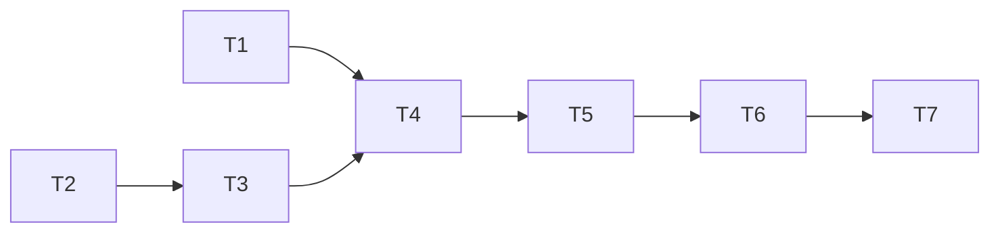

# Alpha Gameplay UX Redesign v2：影響分析與 Ticket 計畫

2026-11-01 T6 補註：本文件保留 2026-10-25 的影響分析與版本提案；現行正式格式已為
Save envelope v7／GameState v1（T4 升版、T5 沿用）。T6 的相容驗收擴至 v1–v7；
執行證據與未完成人工項目見 [UX v2 整合驗收](../UX_V2_ACCEPTANCE.md)。

日期：2026-10-25（Asia/Taipei）。狀態：使用者已確認，授權建票並先實作 T1。目標行為的單一來源為 [UI/UX §11](../UI_UX_SPEC.md#11-alpha-gameplay-ux-redesign-v2)。本計畫採專案 to-spec／to-tickets 的可驗收垂直切片方式；每票獨立驗收、Review、PR 與合併，不一次實作全案。

## 1. 分析基準與進行中工作的邊界

### 1.1 實際查核結果

- 起點分支 `feat/family-life-direction`，HEAD `a08376a25e85597b5e7133d5c56882f5122bf3e6`；開始時 `git status --porcelain=v1` 為空。
- 2026-10-25 唯讀 GitHub 查詢：open PR 清單為空。[Issue #12](https://github.com/gitmaruneko/parenthood-simulator/issues/12) 已關閉，無留言；關閉時間 2026-10-24 22:38:55（台北時間），不是仍待實作。
- [PR #33](https://github.com/gitmaruneko/parenthood-simulator/pull/33) 已合併家庭回顧與重玩；[PR #34](https://github.com/gitmaruneko/parenthood-simulator/pull/34) 已合併 MVP 整合驗收與瀏覽器 CI；[PR #32](https://github.com/gitmaruneko/parenthood-simulator/pull/32) 是已合併開場與成員摘要；[PR #31](https://github.com/gitmaruneko/parenthood-simulator/pull/31) 是已合併生活方向。
- 遠端 main 與本機 origin/main 同為 `5680512f62c7ae25885e404d80abcf18476da734`；`git diff --stat origin/main HEAD` 為空，即兩者檔案樹一致。沒有 checkout、rebase、覆蓋本機 main 或重做上述功能。
- 舊方向實作記錄中「#12／#13 尚開啟」「CI 未跑 Playwright」是當時歷史；目前應以 GitHub 狀態與現有 CI 為準，不據舊文字新增重複工作。
- Cloudflare Pages 已部署為使用者提供的現況。Repository 可確認 Vite 輸出 `dist/web` 與 GitHub CI，未取得 Cloudflare dashboard 的正式 branch、網域、建置設定或部署 SHA；不宣稱已核實線上部署內容。

### 1.2 已閱讀的依據與程式接縫

| 類別 | 已核對來源 | 對本改版的約束 |
| --- | --- | --- |
| 產品與正式契約 | [GDD](../GDD.md)、[MVP Spec](../specs/PARENTING-SIMULATION-MVP.md)、[UI/UX](../UI_UX_SPEC.md)、[Player UI](../PLAYER_UI.md) | 年齡階段／Turn 分離，UI 不擁有模擬規則，測驗仍五題可跳過 |
| 內容範圍 | [Event Backlog](../EVENT_BACKLOG.md)、[MVP Content](../MVP_CONTENT.md)、[內容生成](../../src/content/mvp.ts)、[既有題材](../../src/content/mvp-topics.ts) | 143 候選不等於可玩內容；正式包為 32 敘事節點＋1 fallback，不因改版納入候選內容 |
| 家庭與模型 | [Family Opening](../FAMILY_OPENING.md)、[Schema](../../src/domain/schemas.ts)、[生成器](../../src/engine/family-opening.ts)、[前次影響分析](OPENING-FAMILY-IMPACT.md) | 保留既有 actor ID、人數、家庭三維度、行為參數與 PRNG draw 序列 |
| 引擎 | [Event Engine](../EVENT_ENGINE.md)、[引擎實作](../../src/engine/event-engine.ts)、[effects](../../src/engine/narrative-effects.ts)、[方向決議](../FAMILY_LIFE_DIRECTION_IMPLEMENTATION.md) | 不重寫引擎；新增紀錄在既有決策／完成接縫，不更改 eligibility、Scheduler、反應抽樣或預算 |
| 保存 | [Persistence](../PERSISTENCE.md)、[save format](../../src/persistence/save-format.ts)、[transition/save](../../src/persistence/transition-and-save.ts)、[storage](../../src/persistence/local-save-store.ts) | v3 envelope／GameState v1；每 checkpoint 保存；失敗保留記憶體結果，重試不重送命令 |
| UI／Session | [GameScreen](../../src/ui/GameScreen.tsx)、[App](../../src/ui/App.tsx)、[Session](../../src/ui/player-session.ts)、[樣式](../../src/ui/styles.css) | Session 提供唯讀快照與命令；已有可取消的恢復 Dialog，需新增必要決策語意 |
| 回顧／發布 | [Family Review](../FAMILY_REVIEW.md)、[回顧生成](../../src/engine/family-review.ts)、[ReviewScreen](../../src/ui/ReviewScreen.tsx)、[CI](../../.github/workflows/ci.yml) | 回顧以既有 history IDs 關聯；沿用安全重玩、分享 allowlist 及瀏覽器 CI |

未找到根目錄 GLOSSARY 或 ADR 文件；未自行增加領域術語定義文件。文件中 EventNode、Turn、AgeStage、Choice History 沿用正式 Spec。

## 2. A — 目前 UI／Gameplay 問題

| 問題 | 截圖／程式證據 | 玩家影響與改善 |
| --- | --- | --- |
| 方向區喧賓奪主 | 圖一六張含說明選項；GameScreen direction-options 每項 name＋description＋目前方向 | 改為六項短 Chips，完整說明次要揭示；命令、權重與保存照舊 |
| 成員像條件表，缺乏個體 | 圖二各成人重複 care／work；Session members.context 對每位成人套相同家庭條件 | 統一人物卡，分開家庭安排與人物；補最小人物檔案 |
| 家庭檔案重複且太長 | 圖四 compact FamilyDetails 再遞迴展開完整 FamilyDetails，開場句重複 | 主畫面僅型態、分工、一句背景；詳細資訊次要入口 |
| Journal 缺少可理解情節 | 圖五；FamilyLog 僅取 resolvedEventId，以事件標題＋選項呈現 | 玩家難以知道誰做了什麼；改為完整具體短敘事 |
| 字重層級相反 | FamilyLog 粗體是所有事件標題，choiceText 是普通字重 | 只將已確認玩家選擇正文粗體，日常與結果正常 |
| 故事重複出現 | 圖六同 Turn history、ConfirmedChoice、獨立 reaction label，再加紀錄／心事 | 主紀錄唯一承接正文；詳情／心事改定位與索引 |
| 閱讀閘門增加機械點擊 | readThrough 為 UI 本地狀態；每次歷史增加都須「繼續故事」再到下一命令 | 移除日常閱讀閘門，保留可選詳情與清楚「繼續生活」 |
| 大型正文擠壓下一步 | 常駐 event-panel 同時容納讀取、事件、反應及系統說明 | 未決選擇移到 Dialog；背景只有紀錄與下一步 |
| 抽象文字源自內容層 | mvp.ts 的安排／追蹤通用句及 none 反應，不只是 CSS 問題 | 首版需要限縮的內容編修與驗證，不能只換 UI 或用新文案捏造結果 |
| 人物細節無來源 | actor.displayName 是角色稱呼；無具體關係、成人年齡或習慣欄位 | 不能將 grandparent 推為婆婆；舊資料未知降級，新家庭版本化生成 |
| 日常與選擇尚無呈現型別 | storyEntry.kind 是 event／reaction／support／repair／planning，choice 另表 | 增加可追溯呈現資料及順序，不用 UI 猜 kind／製造事件 |

## 3. B／C — 資訊架構與 Component 改動

桌面三欄、手機四分頁與中間尺寸抽屜均保留；具體 wireframe、位置、方向高度與首屏驗收以 [UI/UX §11.2–11.3](../UI_UX_SPEC.md#112-桌面手機與中間尺寸資訊架構) 為準。

| 現有責任／元件 | 處置 | 改版後責任 |
| --- | --- | --- |
| GameScreen／game-shell | 修改 | 主欄改以 Journal 為主，保留既有響應式導航 |
| Resources／頁首／SaveNotice | 保留 | 五資源意義、進度、保存與安全恢復不變 |
| direction-panel | 修改 | 六方向短 radio Chips；保留方向 API、即時保存與佇列 |
| FamilyDetails compact | 修改 | 主畫面三項摘要；詳細 FamilyDetails 轉次要頁／抽屜 |
| FamilyMembers | 修改 | 使用共用人物檔案；移除每人重複家庭照顧／工作段落 |
| scene-panel／Illustration | 修改 | 縮小與可收合，不阻擋首屏 Journal |
| FamilyLog | 修改 | 共用 Journal 投影、倒敘、選擇字重與完整敘事 |
| event-panel／story-stream／ConfirmedChoice 常駐正文／reaction-label | 移除常駐呈現 | 詳情可留歷史，決策由 Dialog 接手；不是刪除 history |
| readThrough／必按的「繼續故事」 | 移除 | 可選詳情不擋下一步 |
| 內嵌選項 decisions | 移至新 Dialog | 同一既有 CHOOSE 命令，不保留第二組可點選項 |
| DecisionDialog（責任名） | 新增 | 必要決策、焦點、提交／保存狀態及錯誤恢復 |
| ContinueLifeControl（責任名） | 新增或抽取 | 只提交公開 nextInput，忙碌／未保存時鎖定 |
| ParentThoughts | 修改 | 索引並定位 Journal；不複製相同正文 |
| Growth／ReviewScreen | 保留並相容調整 | 保留 12 階段、3 個時刻及重玩；顯示同源 Journal 文字 |
| App 家庭 reveal | 修改 | 共用人物卡，移除可見傾向；測驗元件不重設 |
| 現有確認／恢復 dialog | 保留 | 仍可取消，與不可略過的重大決策不同；避免堆疊模態 |

## 4. D — 契約缺口與最小擴充

| 邊界 | 現況 | 提案及不變項 |
| --- | --- | --- |
| Family／Actor | FamilyProfile 三維度＋角色 ID；actors 在 ContentPack；新局 replayOrigin 保存 actor 目錄 | GameState 增加按 actorId 的人物檔案與版本，replayOrigin 保存起點檔案。具體規則見 UI/UX §11.4；不把展示資料當新 eligibility／反應參數 |
| 身份解析 | Session 依 role 給稱呼，reveal 不包含成員檔案 | reveal、主畫面、事件及回顧共用身份公開投影；已發生文字保留當時快照，不全局 string replace |
| 現場可用性 | actorAvailable 對一般條件主要代表家庭成員存在；reaction 才另有現場 availability 取樣 | 本版不宣稱有完整出席模型。涉及具體在場／支援必須已有事件事實支持，否則中性文字；不把 family membership 升格成在場保證 |
| Journal | history 與 choiceHistory／reactionHistory 分離；反應 history 無 actorId；原選項文字未快照 | history 增加選填 journal 呈現資料，每個 occurrence 有來源與文字快照；公開投影去重。舊來源配對不確定時不補猜 |
| 順序 | history 為 append array，story ID 以 Turn／nodeIndex；沒有 wall-clock | 沿用 append 順序＋來源內序號，倒敘顯示；不改已有 ID 或時間標籤 |
| 零效果日常 | 現有日常須 EventNode，會計節點預算；無獨立日常提交規則 | Turn 首次確定完成時，純模板產生至多一筆 history 附屬紀錄，固定去重鍵、不 draw。只是紀錄擴充；有 effects 仍走正常節點 |
| ContentPack | 嚴格 Zod／引用檢查，無 Journal 模板或 actor 綁定規格 | 最少新增型別化敘事模板／角色槽位及驗證；允許獨立受驗證的日常目錄，不放 React；不改事件 ID、效果、圖或反應權重 |
| Persistence | envelope v3，GameState v1，未知欄位拒絕；trace checkpoint 保存 | 協調下一格式（建議 envelope v4），逐版舊 schema 驗證及遷移。新增資料須進每個 afterState；不能只最後補保存 |
| Session／Dialog | busy、needsSave、canRetrySave 已保護結果，但接受選擇後 pendingEvent 消失 | 增加 run／occurrence 綁定的提交狀態；保存失敗後仍能顯示該次結果與 retry，不能把 pendingEvent 消失當成功關閉 |
| 回顧 | keyMomentIds／timeline／support／repair 指向 history；主題用已發生證據 | 保留舊 ID 與類型，回顧讀同源投影；daily 不入三大選擇候選，不製造支持／修復主題證據 |

重要取捨：舊檔不能無中生有地獲得完整人物介紹或新的生活往事；第一版允許未知欄位省略。若要求所有舊檔也必有姓名／婆婆等細關係，會違反「不改寫歷史、不虛構人物」；本提案不採用。

### 4.1 與既有正式規格的差異（2026-10-25 已確認）

| 來源 | 既有要求 | 本次提案／處理 |
| --- | --- | --- |
| UI/UX §4–5、§8；PLAYER_UI | 主欄事件正文、同 Turn 串流與每組 AUTO_ADVANCE 閱讀控制 | 改成 Journal 主敘事＋必要 Dialog＋繼續生活；核心自動遍歷／安全邊界保留 |
| UI/UX §5.5；PLAYER_UI | 每事件一筆標題＋選項，不把 reaction 拆紀錄 | 改為按已發生 choice／result／daily 顯示零至多筆完整敘事；既有原始歷史不刪 |
| UI/UX §3；前次開場影響分析 | 成員顯示家庭照顧／工作摘要及成人重複詳情 | 分離家庭摘要與個人介紹，新增檔案契約後才呈現新細節 |
| MVP Spec「Opening assessment」；GDD §7 | 結果顯示 2–3 條目前傾向 | 「認識家庭」移除可見傾向；保留計算、跳過及後續效果。需明確確認此呈現修訂，不刪核心向量 |
| MVP Spec「Family reveal」 | 開場解釋家庭三維度與支援 | 主畫面精簡，開場／次要詳情仍可取得三維度，無須刪 workArrangement |
| MVP Spec「Event model」 | EventNode 是故事原子 | 純零效果日常是已提交的展示紀錄，不是可執行節點；具狀態效果仍 EventNode。此定義擴充需核准，非規避預算 |
| MVP Spec「Randomness」 | seed 只初始化 PRNG、結果可重現 | 人物檔案另用版本化確定性映射，seed 作身份命名空間；此為明列的 seed 使用補充，不挪用引擎 PRNG。若嚴格禁止其他 seed 衍生，需改採由已生成資料映射，並接受名字多樣性較低 |
| UI/UX §11.7 新需求與現有 Persistence | 寫入被拒後只能保留記憶體，讀檔回最後 checkpoint | 不能承諾關閉頁面後仍保留未成功寫入結果。提供保留／重試與離頁提示；若要求跨關閉保證，另立儲存架構案 |
| GDD 舊稿與後續 MVP／實作 | 「12 回合」、五題各四選項、30 件事件；與現況用語不同 | 以正式 MVP 的 12 AgeStage、多 Turn、既有開場前兩題六候選及目前 33 節點為基準；不因本次回退已合併功能 |

生活方向仍全六項直接可見，因此精簡 Chips 不違反既有全部可用項可見規則；權重 1–1.25、一般入口、pending／固定 follow-up 不受方向改動的規則完全保留。家庭資源不重定義。

## 5. E — 最小可行改版

完整首版必含：精簡方向／家庭檔案、可信人物介紹、新家庭人物檔案與舊檔未知降級、同源 Journal、既有內容的具體敘事整理、少量零效果日常、重大決策 Dialog、回顧與保存相容，以及手機驗收。

先不做成人生日／年齡推進、職業系統、關係分數、物品／出席新系統、日曆、人物自由編輯、新事件入口、方向重平衡、節日／隔代內容包、帳號、雲端同步、存檔降版或新分享格式。舊檔可安全續玩優先於補齊漂亮介紹。

內容編修要逐項交付改前／改後與事實來源；不能只換通用前綴。新檔使用新文字快照，舊 history.text 不回填新版正文。所有新日常都是小量經驗證目錄，不是擴張可執行節點數。

## 6. F — 已確認 GitHub Tickets

2026-10-25 已建立並讀回驗證：

| 規劃號 | GitHub Issue | 原生 Blocked by |
| --- | --- | --- |
| T1 | [#35：精簡主畫面輔助資訊](https://github.com/gitmaruneko/parenthood-simulator/issues/35) | 無 |
| T2 | [#36：家庭人物檔案](https://github.com/gitmaruneko/parenthood-simulator/issues/36) | 無 |
| T3 | [#37：選擇與結果紀錄](https://github.com/gitmaruneko/parenthood-simulator/issues/37) | #36 |
| T4 | [#38：日常與主紀錄](https://github.com/gitmaruneko/parenthood-simulator/issues/38) | #35、#37 |
| T5 | [#39：重大抉擇 Dialog](https://github.com/gitmaruneko/parenthood-simulator/issues/39) | #38 |
| T6 | [#40：UX v2 整合驗收](https://github.com/gitmaruneko/parenthood-simulator/issues/40) | #39 |
| T7 | [#41：Preview 與相容發布](https://github.com/gitmaruneko/parenthood-simulator/issues/41) | #40 |
| 後續 | [#42：Family-Conditioned Event Expansion](https://github.com/gitmaruneko/parenthood-simulator/issues/42) | 不阻塞 T1–T7 |

建議依序 #35 → #36 → #37 → #38 → #39 → #40 → #41；#36 沒有依賴 #35，仍依使用者要求每次只交付一票。#42 先核定候選矩陣與分布容差，獨立排程。

代號 T1–T7 是本地規劃號，不是 GitHub issue number；各票驗收需使用真實公開邊界。每票交付可獨立示範的行為，測試及文件納入該票。格式變更集中由 T2 建立遷移基礎，T3 沿用同一整合版本。若分別發布部署，T3 必須再升新版本，不能把不同 schema 都稱 v4。

### T1 — 精簡主畫面輔助資訊，保留玩法

**Blocked by:** 無（已核准，先執行本票）。

**交付：** 玩家在主畫面看見完整但精簡的六方向、簡短家庭檔案及容易到達的詳細資訊；暫不動尚待契約的 Journal／人物生成。

- [ ] 六項自然換行、單選及目前標記清楚；說明可用鍵盤／觸控取得。
- [ ] 指定尺寸方向高度較舊基準減少 ≥40%，放大文字不裁切；家庭摘要不重複成員。
- [ ] 切換仍經既有命令與保存，不改資源、PRNG、pending 或固定 follow-up；完成局唯讀與保存錯誤行為保留。
- [ ] 工作資料及完整說明仍可取得；單一照顧者不誤稱單親。
- [ ] 元件／Session 與桌面／手機案例覆蓋方向、詳情與錯誤；原方向回歸全過。

### T2 — 認識同一個家庭：人物檔案、開場與續玩

**Blocked by:** 無；可與 T1 分開進行。

**交付：** 新家庭在認識家庭、主畫面與事件角色稱呼一致；舊家庭保持可信的中性呈現且可續玩。

- [ ] 最小 actorProfiles／版本及 replayOrigin 起點快照經嚴格 schema 保存，角色引用與關係鏈可驗證。
- [ ] 新家庭名字及習慣有穩定生成來源；包含中性伴侶及明確關係分支，不以 grandparent 推定婆婆、不把長輩固定負面化。
- [ ] 原家庭維度、actors 機械參數、資源及 rngState 在固定 seed 下與改版前 golden fixture 一致；不同測驗答案不改身份。
- [ ] 同一身份解析供 reveal、members、pending event 與回顧使用；舊歷史字串不替換，無角色不顯示／不引用。
- [ ] 移除 reveal 可見傾向，五題、候選展開、跳過與內部向量保留；成人年齡缺少可省略。
- [ ] 各舊版本明確遷移、原 bytes 保留、失敗停止；舊姓名／關係未知不編造，seed 重玩／reroll 仍安全。
- [ ] 以家庭生成、Session、Save/Restore 及完整 reveal→遊玩→重整→回顧的可見身份驗證交付。

### T3 — 選擇與結果成為可保存、可回顧的生活紀錄

**Blocked by:** T2（共用人物身份與格式契約）。

**交付：** 玩家做一次既有選擇，看到清楚的粗體選擇與普通字重結果；讀檔與回顧顯示同一事實，先套用於既有正式內容，不新增事件。

- [ ] history 的 journal 呈現資料、文字快照、來源及固定排序通過 schema／交叉引用驗證，沿用 T2 的版本整合策略。
- [ ] 每個實際 checkpoint 含完整紀錄，CHOOSE／反應不因投影重算；無反應不硬增一筆。
- [ ] 既有內容逐項補具體情境／動作與必要 actor 綁定，effects、反應權重、事件 ID／鏈、資格及節點總數保持相同。
- [ ] 新 Journal 可獨立讀懂，僅選擇粗體；不把「詢問」寫成已完成交接，不揭露排程未來。
- [ ] 最新紀錄置頂，同一 Turn 多筆順序穩定；不重複顯示同一事件正文、選擇及系統摘要，不固定每次三筆，依實際已發生結果決定筆數。
- [ ] 舊檔 legacy 投影可讀，配對不確定或缺原選項原文時保守降級，不重寫歷史。
- [ ] 三個回顧時刻及所有已保存 history 引用不變；相同投影供回顧正文使用，安全分享不增加名字／私密文字。
- [ ] 完整事件／反應 trace、save/restore、回顧與新舊歷史混合排序回歸通過。

### T4 — 日常直接進紀錄，主畫面改以紀錄推進生活

**Blocked by:** T1、T3。

**交付：** 玩家按「繼續生活」即可看到已發生日常，無需逐段按閱讀按鈕，主畫面只有一個敘事流。

- [ ] Turn 首次完成的零效果日常模板、資格、固定選取與去重規則實作並驗證；每 Turn 零至一筆，不增加 EventNode 預算或 PRNG draw。
- [ ] 保存恢復、元件重掛載、換分頁、重試及舊已完成 Turn 均不重複／補造片段。
- [ ] Journal 移至主敘事區；移除大型 event stream、重複反應與必按 readThrough；手機紀錄頁是同源互斥視圖，心事為索引。
- [ ] 「繼續生活」只送公開 nextInput，無效／忙碌／保存阻擋時不可操作，不連發命令越過安全邊界。
- [ ] 暫保留可用的內嵌重大決策直到 T5，不讓此票落地時無法遊玩；T5 再移除內嵌選項。
- [ ] 桌面／手機首屏能找到紀錄、成員入口與下一步；長歷史無不可操作的雙層捲動。

### T5 — 重大抉擇 Dialog 與保存失敗恢復

**Blocked by:** T4。

**交付：** 每個必要決策聚焦彈出，選後確認保存才返回主紀錄；失敗保留同一結果。

- [ ] 所有 pending occurrence（含讀檔）開啟唯一 Dialog；移除主畫面重複選項，開關不送命令／draw。
- [ ] 使用引擎已過濾選項並由 CHOOSE 再驗證，不顯示數值增減；鍵盤／螢幕閱讀器標題、描述與狀態可讀。
- [ ] 背景 inert、焦點進入／限制／返回正確；Escape、遮罩無法略過必要選擇，長文及短螢幕皆能操作。
- [ ] 同 tick 雙擊／Enter＋click／延遲／重掛載只提交一次；結果綁定 run＋occurrence，不影響下一局／下一事件。
- [ ] 命令拒絕保留可重試事件；接受後保存失敗轉保存重試狀態，pending 消失也不關閉，重試不重送 CHOOSE。
- [ ] 保存成功關閉並定位最新紀錄；Quota／拒絕存取／驗證錯誤／跨分頁衝突有可達恢復動作，舊資料不被覆蓋。
- [ ] 抉擇及必要保存完成後直接返回主畫面，顯示新增紀錄，不再要求另一個閱讀確認。
- [ ] 未保存離頁限制如實呈現；不承諾關閉分頁後仍保留遭拒寫入的記憶體資料。

### T6 — 全局回顧、舊檔與內容整合驗收

**Blocked by:** T5。

**交付：** 四種基準家庭情境完整走完 12 階段，重整及回顧／兩種重玩均可靠，並留下驗收證據。

- [ ] 至少一條固定 seed／固定輸入完整 trace 對比：新增敘事前後資源、PRNG、事件／反應／排程／節點預算相同。
- [ ] v1／v2／v3、pending input、Turn 中途 checkpoint、已完成且有自選 keyMomentIds、缺 replayOrigin、損壞／未知版本皆驗證。
- [ ] 新增 daily 不進重大時刻／支持修復主題候選；回顧十二段、三個可調整時刻、分享 allowlist 與兩種重玩維持有效。
- [ ] 實際 UI 對照內容清單：無未知角色、無未發生支援、無相同段落重複展示、無剩餘必按閱讀閘門。
- [ ] npm tests／typecheck／build／E2E 通過，人工可及性／體驗時長未通過項目逐項記錄，不用模擬瀏覽器結果替代實機審核。

### T7 — Cloudflare Pages 預覽、相容發布與回滾演練

**Blocked by:** T6。

**交付：** 可審核的 Preview 與正式發布檢核；實際正式部署另依使用者確認執行。

- [ ] 核實 Cloudflare 現行 production branch、網域、部署 SHA、Node、build command 與 `dist/web`，不另建站或變更 hosting 架構。
- [ ] Preview 以測試存檔驗證新局／舊檔遷移／pending Dialog／回顧；另於相同 origin 的升版測試證明儲存持續性，不以跨 origin 空槽判遺失。
- [ ] 驗證保留原始 bytes、遷移失敗可停、背景舊分頁遇新版格式安全拒絕；公開未保存離頁限制。
- [ ] 記錄新版格式對舊 bundle 的不相容及可讀新格式的修復／回滾方案；不自動降版、清存檔或清除 LocalStorage。
- [ ] 正式發布後只以測試資料做 smoke，記錄部署 SHA 與驗收結果，不宣稱備份可自動還原。

T1／T2 無彼此阻塞，T6／T7 是全局整合與發布門檻；每個功能 Ticket 仍須自己附測試，不能把所有測試延後到 T6。

## 7. G — 必要測試與驗證接縫

以現有最高可用公開邊界為主：Family Generation、Core Event Engine、Content Validation、Save/Restore；Session 以真實引擎／記憶體 storage 整合，React 以公開快照與命令 spy，Playwright 驗證實際流程。無需為每個元件創造領域 API。

| 類別 | 必要案例 | 主要既有測試落點 |
| --- | --- | --- |
| 人物一致性 | 固定 seed／目錄排序、測驗不改身份、新局與 reroll；中性伴侶、玩家側／伴侶側長輩；未知舊關係不推定；生成機械結果不變；reveal／事件／紀錄／回顧同人 | [family-opening](../../tests/family-opening.test.ts)、[player-session](../../tests/player-session.test.ts)、[player-ui](../../tests/player-ui.test.tsx) |
| 選擇紀錄 | 只記已接受 choice；詢問不變成承諾；文字快照跨內容編修不變；none 可零筆；預期評價不冒充實際反應；選擇粗體、其他正常 | [event-engine](../../tests/event-engine.test.ts)、[player-ui](../../tests/player-ui.test.tsx) |
| 順序與去重 | 同 Turn 多節點／反應／effects／日常、跨 Turn 與階段、重複 event occurrence；每個 id 唯一，確定排序；重掛載／換頁／重試／還原不重生 | [event-engine](../../tests/event-engine.test.ts)、[player-view](../../tests/player-view.test.ts)、[player-session](../../tests/player-session.test.ts) |
| 內容與預算 | 模板缺角色／未知引用／無效序號／重複 ID 拒絕；零效果日常不改資源／flags／PRNG／排程／4及6節點上限；有 effects 必走 EventNode | [content-validation](../../tests/content-validation.test.ts)、[mvp-content-engine](../../tests/mvp-content-engine.test.ts) |
| 保存恢復 | 各舊版本、strict 欄位、每個 trace checkpoint；失敗後同 state 重試、原 bytes 保留、備份失敗停止、衝突不覆蓋、pending 相同選項、讀檔不 draw | [persistence](../../tests/persistence.test.ts)、[player-session](../../tests/player-session.test.ts) |
| Modal | 初始／讀檔焦點、Tab／Shift+Tab、Escape／遮罩、背景不可操作、焦點返回；延遲保存、雙擊、命令拒絕、保存錯誤、run 世代切換 | [player-ui](../../tests/player-ui.test.tsx)、[player-flow](../../tests/e2e/player-flow.spec.ts) |
| 手機與無障礙 | 320／390／768／1024／1440px、橫向／短視窗、長姓名／選項、200% 文字與400%重排、44px操作區；紀錄首屏、方向高度、底列不遮焦點 | [player-flow](../../tests/e2e/player-flow.spec.ts)；桌面／手機螢幕閱讀器、Safe Area 及虛擬鍵盤另人工 |
| 回顧與重玩 | 十二階段、多 Turn、自選三個既有 history ID 還原、daily 不成關鍵選擇、支持修復與主題證據、同 seed 起點人物與 rng、新家庭安全替換、分享無姓名／歷史 | [family-review](../../tests/family-review.test.ts)、[mvp-acceptance](../../tests/mvp-acceptance.test.ts)、[player-flow](../../tests/e2e/player-flow.spec.ts) |

未來實作須執行 package scripts：`npm test`、`npm run typecheck`、`npm run build`、`npm run test:e2e`（PowerShell 可用 npm.cmd）。本次文件驗證只檢查連結、diff 與範圍，不宣稱上述功能測試已執行或通過。

## 8. H — 存檔與 Pages 上線影響

- 純版面調整可獨立落地，不需改 key、刪除 workArrangement 或搬移存檔；人物及 Journal 則需要明確格式升級與部署相容計畫。
- 原始 key `parenthood-simulator.save`、既有 `.preserved.N` 原檔保留機制沿用。資料量因文字快照與日常增加，應以完整 12 階段量測實際 serialized bytes；不任意截斷歷史或自動清備份來處理 quota。
- 遷移及讀取不改變既有 PRNG、已發生結果或已排程事件；新日常只在未來實際完成的 Turn 寫入，不為舊進度回補生活。
- 不變動 Cloudflare Pages hosting、站址、域名或資源含義。Repository CI 已有 Node 22／24 的 tests、typecheck、build，以及 Node 24 的桌面／手機 Chromium E2E；這不代表線上部署或人工輔具驗收已通過。
- Preview 不可讀 production LocalStorage；不同網域／協定也不共用。使用匿名測試存檔與相同 origin 升版流程，避免索取或發布玩家真實資料。
- 發布時保留可讀新版格式的修復 bundle。舊版本 strict parser 會拒絕新資料，回滾程式不是回滾存檔；不可回填舊 schemaVersion 欺騙 parser。
- 保存被瀏覽器拒絕時，頁面存活期間可保留已接受結果並重試；關閉後僅能恢復最後成功 checkpoint。這是既有儲存限制，須如實呈現，若需更強保證另開設計案。

## 9. 已確認決議與下一步

使用者已確認 T1–T7 粒度／依賴，以及舊檔未知身份保持中性、純敘事日常不占節點、保存失敗保留頁面內結果且禁止推進／關閉後回最後成功 checkpoint。新增驗收逐項納入 UI/UX §11 的「已確認決議與交付門檻」，並分配至對應 Ticket；核准不等於尚未實作項目已通過驗收。

建票前再次核對所有 open／closed Issues：#29／#30 已完成方向機制，#11 已完成原玩家 UI，#12 已完成回顧，均不重開或複製；#13 保留原 MVP 全局／人工驗收，T6 只驗收 UX v2 新增／變更的整合行為並引用既有證據。#28 是舊方向 Spec，不冒充本案父 Ticket。未發現本次八張新票的重複項目。

後續獨立 Ticket：**Family-Conditioned Event Expansion**。增加每個 AgeStage 符合實際家庭條件的多個一般入口候選，沿用 eligibility／方向權重／seeded PRNG，驗證家庭條件差異、事件分布與 save/restore 可重現性。不作 T1–T7 blocker，也不在本次 UI PR 擴增內容。內容配額、家庭矩陣及統計容差須在該票實作前明確定案，不以「多樣化」作無法驗收的承諾。
